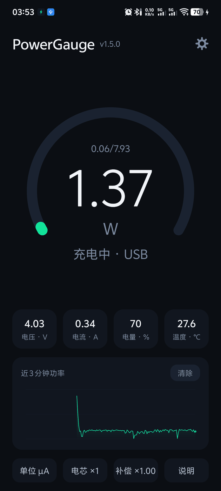
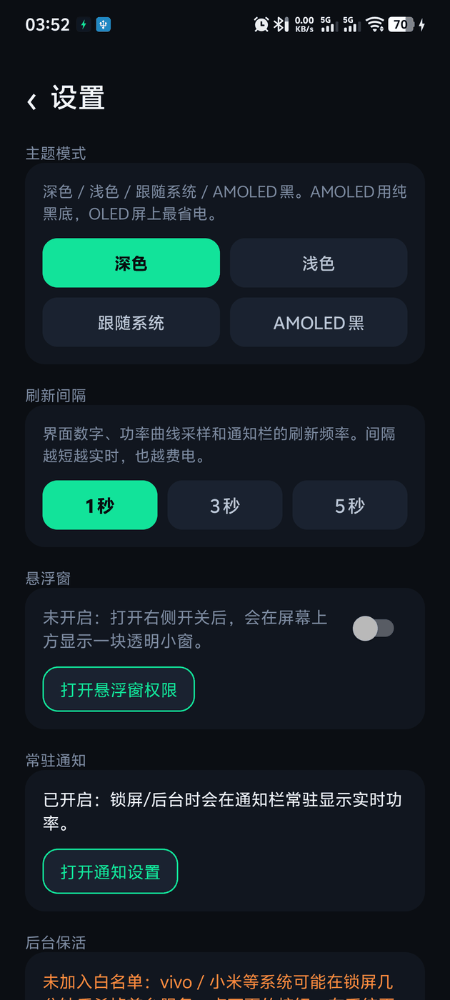

# PowerGauge —— 极简 Android 电池功率计

一个极简的 Android 电池功率计：实时显示电池端电压、电流、功率、电量与温度，并画一条近 3 分钟的功率曲线，支持常驻通知与桌面悬浮窗。

**这是粉丝向重写，非官方作品**，与原作者没有任何隶属关系。功能与交互参考自 B 站 UP 主「晨钟酱Official」的视频《完全免费！我做了一款“小而美”的工具...》（[BV1ScKmzUEbr](https://www.bilibili.com/video/BV1ScKmzUEbr/)）

## 下载

[](https://github.com/shixianzhou/powergauge/releases/latest)

到 [Releases](https://github.com/shixianzhou/powergauge/releases/latest) 下载最新的 `PowerGauge-x.y.z.apk`，传到手机上直接安装。Android 8.0 及以上，无需 root，不联网。

> **升级提醒**：v1.5.0 起换用了新的签名证书。如果你装过更早的包，需要先卸载旧版再安装，否则会提示「应用未安装」。此后版本可以正常覆盖升级。

| 项目 | 值 |
| --- | --- |
| 包名 | `com.powergauge.app` |
| 版本 | 1.5.0 (versionCode 8) |
| minSdk / targetSdk | 26 / 34 |
| 语言 | Java 17 |
| 第三方依赖 | **无**（不用 AppCompat / Material / Kotlin） |

## 真机截图
<p align="center">
  
  
</p>

## 致谢与声明

- **灵感与功能参考**：晨钟酱Official 的《功率计》2.0.0 及其视频（[BV1ScKmzUEbr](https://www.bilibili.com/video/BV1ScKmzUEbr/)）
- **非官方、不商用**：不收费、不接广告、不提供付费版；
- **原创声明**：本仓库只包含独立编写的代码与自绘资源，不包含原版 App 的任何代码、图标、字体或截图；原版《功率计》不在本仓库的授权范围内。
- **授权**：本仓库代码以 [MIT](LICENSE) 授权。若原作者对公开方式有异议，联系我即可下架，不需要理由。

## 目录结构

```
powergauge/
├── build.gradle                  # AGP 8.5.2
├── settings.gradle
├── gradle.properties
├── gradle/wrapper/gradle-wrapper.properties   # Gradle 8.7
└── app/
    ├── build.gradle
    ├── proguard-rules.pro
    └── src/main/
        ├── AndroidManifest.xml
        ├── java/com/powergauge/app/
        │   ├── MainActivity.java   # 单页界面（代码搭 UI）
        │   ├── SettingsActivity.java # 设置页（主题 / 刷新间隔 / 通知 / 电池白名单）
        │   ├── Theming.java        # 四档主题与全部配色
        │   ├── IconView.java       # 齿轮图标（Canvas 画）
        │   ├── PowerService.java   # 前台服务 + 通知
        │   ├── Sampler.java        # 解析 ACTION_BATTERY_CHANGED
        │   ├── Prefs.java          # 单位 / 电芯数 / 补偿因数 / 刷新间隔 / 主题
        │   ├── GaugeView.java      # 240° 仪表盘
        │   ├── ChartView.java      # 180 点功率曲线
        │   ├── Bus.java            # 进程内读数总线 + 最低/最高统计
        │   ├── OverlayWindow.java  # 悬浮窗（四行读数，可拖动）
        │   └── Fmt.java            # 数字格式
        └── res/
            ├── values/strings.xml  # 文案（含「使用说明」全文）
            ├── values/styles.xml
            └── drawable/           # 图标（矢量）
```

## 怎么构建

本工程是纯 Java + 零依赖的常规 Android 项目，任选一种：

**A. Android Studio**

1. `File → Open` 选 `powergauge` 目录；
2. 连手机，点 Run。`debug` 包可直接装。

**B. 命令行**

```bash
cd powergauge
./gradlew assembleDebug
```

## 发行包（release）

```bash
./gradlew assembleRelease
# 产物：app/build/outputs/apk/release/app-release.apk
```

## 用法与已知限制

- **功率显示 0.00 或明显偏小**：点底部「单位」在 µA / mA 之间切换。多数手机上报 µA，少数机型上报 mA
- **双电芯 / 三电芯机型**：点「电芯」，选 2 或 3，功率会按倍数校正（电池并联，电流是总和）。
- **读数比充电头输出小是正常的**：本工具读的是电池侧（降压后）的数据，充电有转换效率损耗。想要近似充电头功率，把「补偿」调到 1.05~1.30。
- **OPPO / 一加 / realme（部分联发科机型）**：厂商没开放 battery 服务，读不到正确电压，工具里会提示「读不到电压」，这个改不了。
- 电流方向按系统充电状态判定，不依赖符号（各家符号相反）。